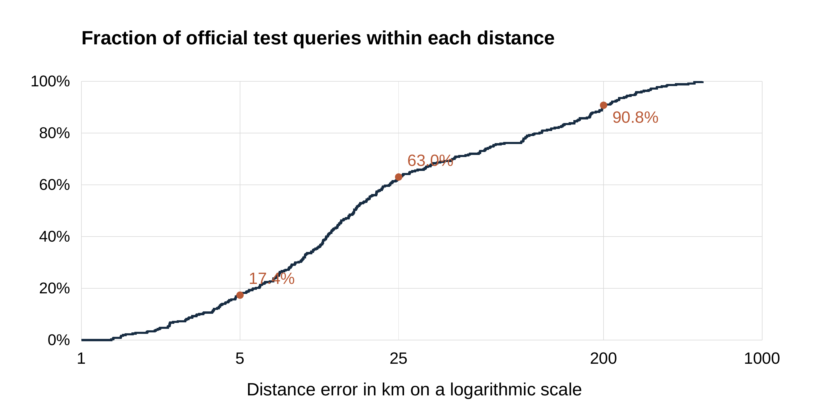

# KPlaceNet Kerala Visual Geolocation

Indian Institute of Information Technology Kottayam

Department of Computer Science and Engineering

CSE 311 Artificial Intelligence

Submitted to Dr Sushitha Susan Joseph

22 October 2026

Prajwal Kumar K 2024BCS0096

Chandra Teja P 2024BCS0120

ShivKarthik Suresh 2024BCS0092

Hari Krishnan S 2024BCS0116

# 1 Abstract

KPlaceNet is a single-image visual geolocation system developed for Kerala-area street photographs. We investigate three complementary ways to turn learned visual features into geographic estimates: a ResNet-50 classifier over 300 geographic cells, the same classifier combined with five-nearest-neighbor class votes, and reference-image retrieval using combined ResNet-50 and DINOv2 descriptors. The retrieval method is the default demonstration path. It returns the recorded GPS coordinate of a matched training photograph rather than directly regressing an unrestricted latitude-longitude pair.

The regional dataset contains 15,939 training images, 1,000 validation images and 357 official test images extracted from OSV-5M. We standardize image preprocessing, keep held-out IDs outside the reference banks, and evaluate haversine distance errors. On the reused official test subset, the deployed retrieval method achieves 17.37% within 5 km, 63.03% within 25 km and a median error of 15.92 km. The classifier-plus-neighbor option achieves 53.50% within 25 km with a 21.84-km median. These results support useful regional localization but do not establish street-level precision or reliable rejection of foreign scenes.

The system also provides an interactive image upload, method comparison, geographic display, retrieved-reference view and Google Maps link. Spatial analysis shows that random validation contains many locations near training images, making it easier than the official test. We therefore separate validation and test claims, document the reused benchmark, and report unsuccessful prototype and additional-data experiments without presenting them as deployed improvements. [1, 6, 7]

Keywords: visual geolocation, Kerala, ResNet-50, DINOv2, image retrieval, nearest neighbors.

# 2 Introduction

Visual geolocation estimates where an image was captured from appearance alone. Unlike reading an embedded GPS tag, the task requires extracting geographic evidence from visible content. Architecture, road markings, terrain, vegetation and urban form may carry useful information, although these cues are often shared by distant locations. A single image can consequently support an approximate regional estimate while remaining insufficient to determine an exact camera position.

KPlaceNet studies this problem in a restricted Kerala-area setting suitable for a reproducible course project. Restricting the geographic search reduces the scale of the task, but does not eliminate ambiguity or uneven data coverage. We use pretrained visual networks to avoid learning all visual structure from scratch and compare cell classification with training-reference retrieval. The distinction matters: a classifier outputs a category whose center is then looked up, whereas retrieval outputs a stored reference coordinate.

The project emphasizes an auditable connection between model behavior and evaluation. A map marker, a high similarity score and several successful examples are not substitutes for distance-based testing. Our report therefore explains the complete pipeline, the role of KNN in the regional selector, the observed geographic distribution of the data, and the limits of the current measurements. The scope is the Kerala-area implementation and its regional alternatives; no worldwide performance claim is made.

<!-- PAGE -->
# 3 Problem Statement

Given one RGB photograph without using its GPS metadata, estimate a geographic location from visual evidence within the project's regional coverage. The inference function must accept image pixels, apply a saved model and return a coordinate that can be displayed and inspected. For evaluation only, a known reference coordinate is available to measure error.

The central challenge is that appearance does not uniquely identify geography. Similar roads, vegetation and building styles can occur far apart, while two views of the same place may differ because of viewpoint, lighting, weather or occlusion. Sparse or geographically concentrated references make this problem harder. The system must also distinguish the meaning of its output: a geographic class center is not the observed position of a query, and a retrieved reference's coordinate need not equal the query camera's position.

The regional collection is defined by a latitude-longitude rectangle, approximately 8.0-12.8 degrees north and 74.5-77.5 degrees east. It includes neighboring territory and is not an audited Kerala administrative polygon. The current methods assume a relevant regional input and always return a highest-ranked regional candidate. Rejecting arbitrary out-of-region or unlocalizable images is outside the implemented decision rule.

We evaluate usefulness through the distribution of haversine errors rather than through the number of decimal places in a coordinate. Successful localization at a radius r means that the predicted position lies at most r kilometers from the recorded test position. Exact-cell accuracy and visual similarity scores answer different questions and must not be substituted for this measure.

# 4 Objectives

The project has the following operational objectives.

1. Construct a regional OSV-5M dataset with separate training, validation and official test subsets and auditable image IDs.
2. Implement consistent RGB conversion, image resizing, center cropping and input normalization for query and reference processing.
3. Use a geolocation-adapted ResNet-50 representation for 300-cell classification and weighted training-neighbor class voting.
4. Combine ResNet and frozen DINOv2 descriptors for fine-coordinate reference retrieval, avoiding the fixed 300-center output restriction.
5. Compare the implemented alternatives using distance thresholds, median and mean error, and explicitly account for nearby-scene overlap and benchmark reuse.
6. Provide a practical local demonstration with method selection, a geographic marker, a visible reference where available and an external coordinate link.
7. Investigate additional imagery and geographic prototypes under explicit deployment conditions, retaining the working method when an experiment does not satisfy those conditions.

<!-- PAGE -->
# 5 Dataset Description

## Source and regional extraction

OSV-5M is an open benchmark of georeferenced street-view images. Its published design uses geographic separation between source training and test sets, making it suitable for studying geographic generalization rather than only matching duplicate views. We use the pinned dataset revision cff33609b56b54d8743b7ee7a416eb8433e9a681 and retain the source image IDs for traceability. The dataset card specifies the CC BY-SA 4.0 license. [1, 8]

Our extraction selects positions inside the regional rectangle. From 16,939 source-training entries, a seed-42 holdout selects 1,000 validation images and leaves 15,939 training images. A further 357 regional images come from the official test archives. The validation images retain source-training storage paths, but they are excluded from regional fitting and from the deployed retrieval banks. Source directory names alone therefore do not identify an example's experimental role.

| Subset | Images | Experimental role |
|---|---|---|
| Training | 15,939 | Learn parameters and populate reference banks |
| Validation | 1,000 | Choose configurations and check deployment conditions |
| Official test | 357 | Report distance errors after method selection |
| Total regional records | 17,296 | Combined inventory across the three subsets |

Table 1. Regional image inventory and experimental roles.

## Record schema and integrity

Each CSV record stores an image path, latitude, longitude, a coarse locality annotation and an OSV image ID. The locality annotation is not a model input or a dedicated city-classification target. The prediction pipeline reads the image rather than its caption or ID. Coordinates define geographic labels during fitting and provide reference or evaluation positions.

The current inventory check found no missing coordinate pairs and no missing referenced image files in any of the three CSVs. Each subset contains unique image IDs and unique coordinate pairs, and the recorded split audit reports zero ID intersection between every pair of subsets. These checks establish record integrity; they do not establish that all images are visually distinct or that every GPS tag is correct. [7]

## Data used by the deployed system

Both reference banks contain the 15,939 training entries only; held-out queries are excluded. Panoramax candidates were encoded separately but not deployed. Section 8 analyzes coverage and class frequency; Section 11 describes the additional-data experiment.

<!-- PAGE -->
# 6 Methodology

## System overview

We separate preparation from online inference. During preparation, training coordinates define geographic cells, visual models are fitted or loaded, and training-reference descriptors are cached. During online inference, an uploaded query is processed using matching transforms and the selected method returns a coordinate. No parameter update occurs when the user presses Locate photo.

The default path uses two encoders. The geolocation-adapted ResNet-50 backbone produces a 2,048-dimensional descriptor. The frozen DINOv2 ViT-S/14 encoder produces a 384-dimensional descriptor. Each descriptor is normalized separately, scaled to give equal similarity contribution and concatenated into a 2,432-dimensional representation. Cosine similarity to all training references determines the top-one match. [2, 3, 6]

Caption: Figure 1. Schematic processing diagram for the deployed fine retrieval path. The reference bank is prepared from training images; the query is encoded at inference. The figure represents computation, not geographic map geometry. Source: project implementation [6].

The two cell methods use the same regional ResNet descriptor but a different output rule. Classifier-only selects a cell through a trained linear head. Classifier-plus-KNN blends that head's probabilities with the class labels of five similar training references. Both then look up the selected cell's saved center. Fine mode instead returns an individual reference coordinate.

## Information supplied to the model

The query's inference input is the processed image tensor. Uploaded GPS metadata, locality captions and file IDs do not determine the prediction. A known training reference contributes its stored coordinate or class only after visual matching. This distinction allows test-query IDs to remain outside the bank while still making use of labeled training examples.

Fine retrieval removes one particular resolution restriction: its output is no longer limited to the 300 class centers. It does not become unrestricted coordinate regression. Its possible top-one outputs remain the bank's stored positions, and successful close localization depends on having an appropriate geographically nearby reference.

<!-- PAGE -->
## Fine coordinate retrieval

Let r(x) and d(x) denote the ResNet and DINO descriptors of image x. Normalize each vector by its Euclidean length. For normalized descriptors r_hat and d_hat, the fused representation is

Equation: z(x) = concatenate(sqrt(0.5) r_hat(x), sqrt(0.5) d_hat(x)).

The vector dimension is 2,048 + 384 = 2,432. Scaling by sqrt(0.5) makes the cosine score between fused descriptors equal to an equally weighted sum of the two encoder cosine scores, up to storage rounding and renormalization. A larger descriptor dimension therefore does not by itself give ResNet a larger contribution.

For query q and reference descriptors z_i, the search selects i_star = argmax_i cosine(z(q), z_i). The latitude and longitude of reference i_star become the result. The app displays cosine similarity as appearance similarity, not as the probability that a location is correct. It also shows the matched training image if its original file is locally available. The classifier head may be computed by shared regional code, but its winning class does not adjust the fine coordinate.

## Geographic classification and the KNN option

For the cell options, the linear head maps ResNet features to 300 logits. Softmax converts these scores into a class distribution p. The classifier-only prediction chooses argmax p and returns its cell center. The geographic classes are constructed from training coordinates with K-means; they are not districts or a uniform administrative grid.

Enabling Regional cells ResNet plus KNN finds the five references with highest cosine similarity in ResNet feature space. With similarity s_i, reference weight w_i is proportional to exp(s_i / 0.07), normalized across the five neighbors. We sum weights for references sharing a cell label, producing a vote distribution v. The final scores are

Equation: p_combined(j) = 0.8 p_classifier(j) + 0.2 v_neighbors(j).

| Cell in an illustrative example | Classifier | Neighbor votes | Combined |
|---|---|---|---|
| A | 0.48 | 0.20 | 0.424 |
| B | 0.45 | 0.70 | 0.500 |
| C | 0.07 | 0.10 | 0.076 |

Table 2. Illustrative class-score blend, not an observed project query. Classifier-only chooses A; the blended method chooses B. The returned coordinate changes to B's center, rather than becoming an average of reference GPS positions. If both evidence sources prefer the same cell, the KNN option may leave the marker unchanged. [6]

<!-- PAGE -->
# 7 Data Preprocessing

## Image transformations

Images are decoded and converted to RGB. At inference and cached-feature extraction, the shorter edge is resized to 256 pixels while preserving aspect ratio, followed by a central 224 by 224 crop. This avoids stretching but can remove useful peripheral signs or landmarks. The same deterministic preprocessing is used for reference and query features so that comparisons remain consistent.

Pixel values are converted to floating-point tensors and scaled initially to the range zero to one. The three channels are then normalized with ImageNet means [0.485, 0.456, 0.406] and standard deviations [0.229, 0.224, 0.225]. The resulting single-image tensor has shape 1 by 3 by 224 by 224. Input normalization matches the encoders' expected numerical scale; it is distinct from normalizing the output descriptors to unit length.

The general model-training transform supports random resized crops with scale 0.8-1.0 and horizontal flips with probability 0.5. These augmentations expose the classifier to altered appearances. The later frozen-feature head fitting and bank extraction use the deterministic view pipeline instead. This difference in view preparation is relevant when interpreting comparisons between trained checkpoints.

## Coordinates and geographic targets

Training GPS positions are grouped into 300 regional cells. Each saved cell includes an identifier, center, bounds and a count. Cell assignment supplies the classifier target; it is not an extra input channel attached to the image. Fine mode retains reference coordinates directly instead of converting the final output through the class center.

The installed regional head uses geographic label smoothing. The target is 90% hard assigned class plus 10% of a geographic distribution whose mass decreases with haversine distance from the training GPS to cell centers, using a 15-km scale. This soft target reduces an abrupt all-or-nothing penalty near geographic boundaries. Only training coordinates are used to construct these fitting targets. [7]

## Cached descriptors and artifact consistency

Reference descriptors are computed once while encoders are frozen. The compact fine bank stores its 2,432-dimensional descriptors in FP16; runtime converts them to FP32 and renormalizes for search. A separate deployment check verified the compressed bank's reported official-test threshold counts and median.

Model fingerprints are checked so a bank is not accidentally paired with a different ResNet or DINO checkpoint. These identity checks protect reproducibility, not predictive correctness. Neither missing-GPS record checks nor fingerprint validation proves that an uploaded image has a uniquely localizable appearance.

<!-- PAGE -->
# 8 Exploratory Data Analysis

## Geographic coverage

We inspected coordinates before interpreting model scores. The training positions span latitudes 8.18284-12.79964 and longitudes 74.90226-77.49984. The official test positions span 8.12432-12.67493 and 75.06518-77.49543. No missing coordinates were found. These ranges describe the recovered regional subset, not the complete OSV-5M release.

Caption: Figure 2. Actual training and official test positions from the regional CSVs. Each panel uses the same coordinate limits; all positions are plotted. This is a latitude-longitude scatter plot with no administrative boundary, not a map proving Kerala membership. Source: regional CSV inventory [7].

The training points are concentrated along capture routes rather than forming uniform area coverage. This is expected for street imagery but means that a dense set of references on one road does not provide equivalent coverage of unsampled rural or hill areas. Regional bounding-box inclusion should not be interpreted as balanced sampling of every locality.

The test subset is smaller and follows a harder separation policy than the random validation holdout. Visual inspection of coordinate coverage alone cannot establish viewpoint overlap or GPS quality, but it exposes why a location-based method may perform differently across parts of the region.

## Implications for inference

Top-one retrieval can only return a reference position. If the closest reference coordinate to a query is several kilometers away, an appearance model cannot return a sub-kilometer position through that lookup alone. Classification additionally incurs the distance between an image's true position and the chosen class center. The map and the retrieval bank therefore impose different geometric resolution limits even before appearance errors are considered.

<!-- PAGE -->
## Geographic class frequency

The 15,939 training images occupy all 300 assigned classes. Frequencies range from 6 to 252 images per class, with a median of 46 and a mean of 53.13. The largest class is 42 times the smallest. The 30 most frequent classes contain 24.36% of training entries, showing that a small fraction of classes accounts for a substantial part of the available evidence.

Caption: Figure 3. Counts of actual assigned training labels, ordered by frequency. The first 30 ranks are highlighted; rank order is not a geographic direction. Source: frozen training-feature labels and regional EDA inventory [7].

These counts make class balance a relevant modeling issue. Sparse classes offer fewer examples of viewpoint and appearance variation, while repeated views from frequently captured areas can dominate nearest-neighbor evidence. The count distribution does not by itself establish a causal explanation for any particular failure, but it argues against treating aggregate accuracy as uniform across the region.

## Spatial separation across splits

| Audit measure | Random validation | Official test |
|---|---|---|
| Number of queries | 1,000 | 357 |
| Queries within 1 km of training GPS | 982 | 0 |
| Median distance to closest training position | 0.099 km | 2.520 km |
| Minimum distance to closest training position | 0.004 km | 1.005 km |

Table 3. Recorded spatial audit of the recovered regional subset [7]. Zero image-ID overlap does not imply geographic independence. The 982 nearby validation queries help explain why validation is substantially easier. None of the official test locations is within 1 km of the original reference bank, creating a hard coverage limit for a method restricted to returning reference positions.

<!-- PAGE -->
# 9 Models Used

## ResNet 50 backbone and geographic head

ResNet-50 is a convolutional image encoder using residual connections. A residual block learns a transformation added to its input, helping the optimization of deep networks. We use a pretrained visual backbone adapted for geolocation, remove its original object-classification layer and retain the pooled 2,048-dimensional representation. A linear head maps that descriptor to 300 geographic logits. [2]

The installed head was fitted with the backbone frozen. Geographic smoothing uses AdamW with learning rate 0.0001, weight decay 0.01, batch size 256 and 12 epochs per recipe. Gradients update the head during fitting, while the cached backbone features stay fixed. These settings describe head fitting, not a new end-to-end training of the entire fine retrieval ensemble.

## DINOv2 and descriptor retrieval

The second encoder is the official pretrained DINOv2 ViT-S/14 model. It uses a vision-transformer representation and supplies a 384-dimensional image descriptor. Its weights remain frozen in this project. It contributes general visual features rather than a second independently predicted GPS pair. Equal-weight normalized feature fusion and top-one search define the deployed retrieval model. [3, 6]

## Classifier plus nearest neighbors

The optional cell method uses a nonparametric reference lookup: five similar ResNet training descriptors supply class votes. Nonparametric here means that prediction explicitly consults stored examples instead of fitting another fixed neural classifier. It supplements, rather than replaces, the trained head. Both its raw and blended scores are uncalibrated.

## Interactive implementation

The Python application uses PyTorch and Torchvision for models and transforms, Pillow for image decoding, Gradio for controls and callbacks, and Plotly for the geographic figure. Resources are loaded lazily and cached. The method selector exposes all three regional options, and changes clear the previous result before another inference is run. Fine mode displays the matched training image when that file is present; the Google Maps link opens the returned coordinate without correcting it.

The recorded experiments used an NVIDIA RTX 3050 Laptop GPU with 6 GB memory and PyTorch 2.7.1 plus CUDA 12.8. The local launcher selects a working GPU environment or falls back to CPU. No Kaggle training run or aerial-ground encoder is part of the deployed method.

<!-- PAGE -->
# 10 Results and Evaluation

## Evaluation protocol

Validation is used for method and configuration selection. The fine-retrieval study evaluated six fixed combinations of encoder mixture and neighborhood choice, emphasizing within-5-km validation success with a within-25-km guardrail and a median tie-break. The selected method uses equal ResNet-DINO contributions and one nearest reference. Encoders remain frozen in these comparisons. [7]

We calculate the haversine distance between each predicted coordinate and the recorded test coordinate. The resulting 357 errors are summarized through radius success rates and distribution statistics. A result within 25 km is a different claim from exact-class accuracy, cosine similarity or localization on the correct street.

## Current regional alternatives

| Implemented method | Within 25 km | Median error | Mean error |
|---|---|---|---|
| Classifier only | 47.62% or 170 of 357 | 28.41 km | 85.33 km |
| Classifier plus five-neighbor class votes | 53.50% or 191 of 357 | 21.84 km | 80.65 km |
| ResNet plus DINO reference retrieval | 63.03% or 225 of 357 | 15.92 km | 61.21 km |

Table 4. Recorded results for the currently available regional options on the reused official test subset. The fine column describes the deployed compact bank; classifier results refer to the installed regularized head. No metric in this table is a correctness probability for an individual upload. [7]

Adding class votes improves aggregate within-25-km success by 5.88 percentage points relative to classifier-only. Fine retrieval improves that measure by a further 9.52 points and reduces median error by approximately 27.1% relative to the class-voting option. The comparisons combine different output rules and, for fine mode, a second encoder; they do not isolate a single causal factor.

The default retrieval result is also 62 of 357 within 5 km, or 17.37%, and 90.76% within 200 km. Median error is the middle of the ordered distances; mean error is more sensitive to the long tail of distant mistakes. The current 90th-percentile error is 197.75 km, so improved typical localization coexists with substantial failures.

## Limits of the evidence

These are exploratory follow-ups on an official benchmark already inspected during project development. They are not independent confirmation on a fresh test. We do not claim statistical significance, multiple-seed robustness or performance uniformity across localities. The demonstration photographs were selected from official test archives and are not an unbiased sample of expected performance.

<!-- PAGE -->
## Error distribution and reference coverage

Caption: Figure 4. Empirical cumulative distribution of 357 deployed fine-retrieval test errors. The horizontal axis is logarithmic. Markers show the observed within-5-km, within-25-km and within-200-km fractions, not calibrated probabilities for future images. Source: compact deployment per-query predictions [7].

None of the fine outputs is within 1 km of the official test position. This is consistent with the spatial audit: every official test position is more than 1 km from every reference position in the original bank. A method whose output is one of those positions cannot beat that geometric lower bound, regardless of descriptor quality. This does not mean the same bound applies to the cell methods, whose centers can lie between training positions.

Random validation gives 71.1% within 5 km and a 1.072-km median for the compact fine method. Those larger figures must be read together with the 982 validation locations lying within 1 km of training. They do not demonstrate equally strong localization of new geographic areas.

## Qualitative behavior and deployment checks

A curated Kottayam query, image 1083931132408866, retrieves training reference 309630957741047 near 9.67611, 76.42105 in the checked run. The cosine score is approximately 0.812. This example demonstrates the query-to-reference path but does not establish overall accuracy. Another gallery query labeled Southern Kerala retrieves a northern reference near 12.45793, 75.09220, illustrating a real distant error.

The compact deployment bank was checked against the selected feature recipe, and installed model fingerprints were verified. A software suite of 91 tests passed after the prototype experiment was added. These are software checks rather than localization benchmark samples. The map and reference display improve inspectability: they show what was returned and where it came from, without proving that the matched scene is geographically correct.

<!-- PAGE -->
# 11 Discussion

## Comparison with existing methods

PlaNet formulates image geolocation as classification over geographic cells. It establishes that location-sensitive visual evidence can be learned from image pixels, but the discretization of the output affects spatial precision. Our 300-cell classifier follows that broad formulation at a much smaller regional scale and with a different architecture and dataset. We do not reproduce PlaNet's training setup or compare its headline accuracy directly. [4]

Reference-image retrieval avoids committing every image in a class to one center. Our combined descriptors select an individual reference position, improving observed regional error relative to the current cell options. However, this approach trades the coarse-center restriction for dependence on reference density and visual overlap. It remains a discrete lookup over available reference coordinates.

The ETH Zurich and Google method combines learned ground-view prototypes with aerial-image embeddings and fine S2 geographic codes. Our deployed model has no aerial encoder or jointly trained ground-aerial representation. Their reported result of more than 68% within 200 m on a European evaluation is therefore neither reproduced nor directly comparable to our within-25-km regional result. The research suggests a useful route toward denser geographic representations, but requires data and training components absent from this deployment. [5]

| Approach | Geographic output | Evidence available at inference |
|---|---|---|
| Regional cell classifier | One of 300 centers | Learned image-to-class weights |
| Regional classifier plus KNN | One of 300 centers | Classifier scores and similar training class labels |
| Deployed descriptor retrieval | One training-reference GPS | Combined ground-image descriptors |
| ETH ground and aerial method | Fine geographic cell | Learned prototypes fused with overhead imagery |

Table 5. Methodological comparison. This table compares output structure and evidence, not benchmark accuracy. Methods use different geographic extents, data volumes and evaluation conditions.

## What the project improves and what it does not

The default method removes the 300-center bottleneck and displays a matched reference for inspection. Equal weighting balances the two encoders despite their different descriptor dimensions. The model selects a reference for an unseen query using learned appearance features, then copies its GPS metadata. It does not generate novel coordinates; displayed decimal precision does not establish camera-position accuracy.

<!-- PAGE -->
## Experiments that were not deployed

We implemented a bounded ground-only prototype adaptation using geographic grids, bilinear boundary interpolation and a multi-similarity-style prototype objective with frozen ResNet-DINO features. Direct prototype-coordinate output was weaker on validation. A selected prototype-context re-ranker improved reused-test within-25-km success from 63.03% to 65.83% and median error from 15.92 to 15.57 km, but reduced within-5-km success from 17.37% to 16.53%. It failed the saved fine-precision regression condition and was not installed in the live path. The selected re-ranker used averaged prototype initialization rather than optimized prototype weights. Candidate eligibility filtering was corrected after validation inspection and before that test; this amendment is recorded, making the result explicitly exploratory. [9]

Additional-data work encoded 789 unique Panoramax candidates from 936 source records without retaining full image downloads. Review found menus, indoor scenes and repeated road views among candidates. A reviewed, spatially filtered and thinned 24-reference expansion left validation unchanged and was not promoted. Acquiring or encoding data is therefore reported separately from improving the deployed model. Storage-efficient frozen-feature extraction is useful, but deleting and re-downloading every image each training epoch would not automatically accelerate full encoder training. [9, 10]

## Generalization and failure modes

The main limitations are sparse references, similar appearances across distant locations, uncertain GPS labels, street-imagery bias and optimistic nearby validation scenes. Exact-ID separation prevents one obvious form of leakage but cannot establish sequence or geographic independence. A future split should be fixed by capture route and date, with explicit geographic exclusion, before further fitting or model selection.

The regional pipeline has no validated out-of-distribution detector. A photograph of a foreign landmark can still receive a regional match even at a high cosine score. Restricting the map or adding class votes does not solve this problem. We also do not infer a calibrated probability that a query is within 5 or 25 km. Cell boxes are geographic extents, and the displayed reference is inspectable evidence rather than geometric verification.

## Further work

The next priorities are more evenly distributed, reviewed reference routes and a new untouched spatial and temporal test set. Once relevant visual overlap exists, local feature correspondences and geometric verification could help reject misleading global matches. Cross-view learning with licensed, aligned high-resolution aerial imagery is a larger extension. A smaller geographic cell alone cannot supply the visual evidence or evaluation independence needed for reliable meter-scale localization.

<!-- PAGE -->
# 12 Conclusion

KPlaceNet provides a working Kerala-area visual geolocation pipeline that connects pretrained image encoders, geographic labels, reference retrieval and an interactive application. The current system exposes three regional methods with distinct output meanings. Classifier-only and classifier-plus-KNN select geographic cells and return their centers. The default ResNet-DINO method retrieves a training reference and returns its recorded coordinate.

On the reused official subset of 357 test photographs, the deployed fine method reaches 63.03% within 25 km, 17.37% within 5 km and a median error of 15.92 km. The classifier-plus-neighbor option reaches 53.50% within 25 km with a 21.84-km median. These measurements show a useful regional improvement while making clear that the project is not an exact street-address locator. The absence of sub-kilometer reference coverage in the official subset imposes a specific limit on top-one coordinate lookup.

The analysis also shows why data and evaluation design matter as much as the choice of encoder. Random validation contains many near-training locations, training class frequencies are uneven, and several prototype or additional-data attempts do not improve fine-precision deployment criteria. Retaining a stable method after an unsuccessful experiment is part of a defensible experimental process, not an absence of work.

Our contribution is an implemented and inspectable regional system, a clear account of the KNN class blend versus fine reference retrieval, and evidence that connects software behavior to measured geographic error. Future development should prioritize reviewed geographic coverage, independent route and date evaluation, and verification of promising image matches before claiming substantially finer localization.

## Implementation and reproducibility record

The evaluated implementation is available in the contributor repository at code revision a45a0d89beba92cd0a07cc0dbef267ffbd525654. The default model assets are distributed through the verified Kerala fine-retrieval release; large weights are not embedded in Git history. The committed dataset split audit, selection records, per-query predictions and deployment fingerprints provide the basis for the reported metrics. Experimental prototype evidence is recorded separately and does not change the deployed pipeline. [6, 7, 9]

<!-- PAGE -->
# 13 References

[1] G Astruc, N Dufour, I Siglidis et al. OpenStreetView-5M The Many Roads to Global Visual Geolocation. CVPR, 2024. Project and dataset description: https://osv5m.github.io/ .

[2] K He, X Zhang, S Ren and J Sun. Deep Residual Learning for Image Recognition. CVPR, 2016. Preprint: https://arxiv.org/abs/1512.03385 .

[3] M Oquab, T Darcet, T Moutakanni et al. DINOv2 Learning Robust Visual Features without Supervision. arXiv:2304.07193, 2023, revised 2024. https://arxiv.org/abs/2304.07193 . Official code and pretrained models: https://github.com/facebookresearch/dinov2 .

[4] T Weyand, I Kostrikov and J Philbin. PlaNet Photo Geolocation with Convolutional Neural Networks. ECCV, 2016. https://arxiv.org/abs/1602.05314 .

[5] P Lindenberger, P E Sarlin, J Hosang, M Balice, M Pollefeys, S Lynen and E Trulls. Scaling Image Geo-Localization to Continent Level. NeurIPS, 2025. https://arxiv.org/abs/2510.26795 . Project: https://scaling-geoloc.github.io/ .

[6] KPlaceNet project implementation. Original repository: https://github.com/Asterisk-Hunter/KPlaceNet . Evaluated contributor revision: https://github.com/Prajwal-k-tech/KPlaceNet/tree/a45a0d89beba92cd0a07cc0dbef267ffbd525654 . Relevant modules: demo/app.py, src/model.py, src/dataset.py, src/retrieval.py and src/fine_inference.py. Accessed 22 October 2026.

[7] KPlaceNet regional experiment and deployment records. Repository directories docs/results/l6_kerala_20261020, docs/results/l7_kerala_knn_20261020, docs/results/l10_precision_20261021 and docs/results/fine_deployment_20261021. https://github.com/Prajwal-k-tech/KPlaceNet/tree/a45a0d89beba92cd0a07cc0dbef267ffbd525654/docs/results . Includes split audit, recorded selection records and per-query error CSVs. Accessed 22 October 2026.

[8] OSV-5M dataset distribution. Hugging Face dataset osv5m/osv5m, revision cff33609b56b54d8743b7ee7a416eb8433e9a681. CC BY-SA 4.0. https://huggingface.co/datasets/osv5m/osv5m . Accessed 22 October 2026.

[9] KPlaceNet experimental geographic prototypes and additional-data records. docs/results/eth_ground_prototypes_20261021.md and docs/results/panoramax_20261021. https://github.com/Prajwal-k-tech/KPlaceNet/tree/a45a0d89beba92cd0a07cc0dbef267ffbd525654/docs/results . Experimental methods were not deployed. Accessed 22 October 2026.

[10] Panoramax contributors. Panoramax documentation and federated image metadata. https://docs.panoramax.fr/ . Candidate-specific authors, coordinates, source links and licenses are retained in the encoded metadata manifest. Accessed 22 October 2026.
