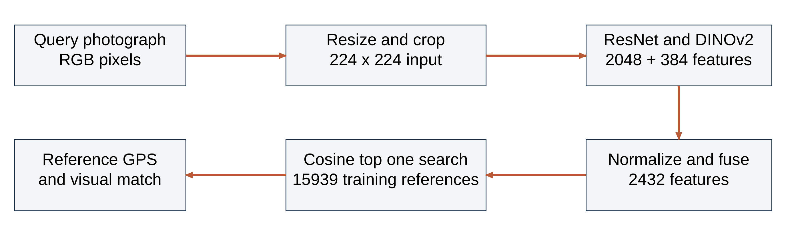
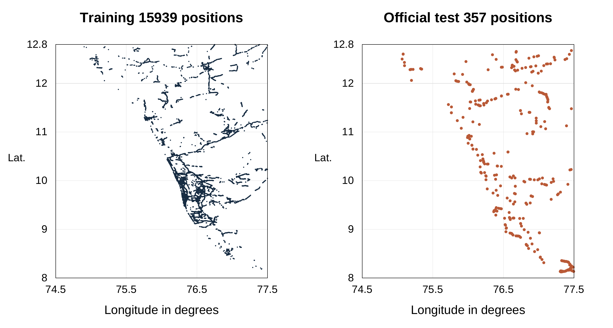
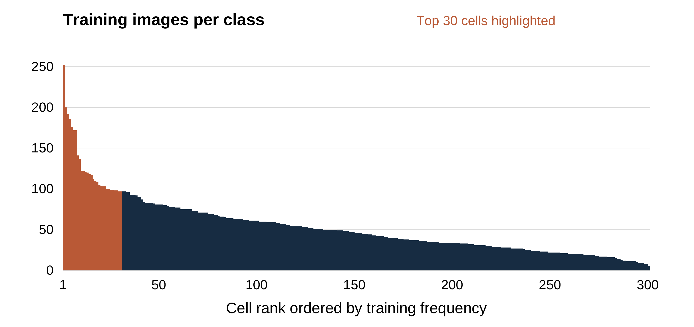

# KPlaceNet Kerala Visual Geolocation

Indian Institute of Information Technology Kottayam

Department of Computer Science and Engineering

CSE 311 Artificial Intelligence

Submitted to Dr Sushitha Susan Joseph

22 October 2026

Prajwal Kumar K 2024BCS0096

Chandra Teja P 2024BCS0120

ShivKarthik Suresh 2024BCS0092

Hari Krishnan S 2024BCS0116

# 1 Abstract

KPlaceNet is a single-image visual geolocation system developed for Kerala-area street photographs. We investigate three complementary ways to turn learned visual features into geographic estimates: a ResNet-50 classifier over 300 geographic cells, the same classifier combined with five-nearest-neighbor class votes, and reference-image retrieval using combined ResNet-50 and DINOv2 descriptors. The retrieval method is the default demonstration path. It returns the recorded GPS coordinate of a matched training photograph rather than directly regressing an unrestricted latitude-longitude pair.

The regional dataset contains 15,939 training images, 1,000 validation images and 357 official test images extracted from OSV-5M. We standardize image preprocessing, keep held-out IDs outside the reference banks, and evaluate haversine distance errors. On the reused official test subset, the deployed retrieval method achieves 17.37% within 5 km, 63.03% within 25 km and a median error of 15.92 km. The classifier-plus-neighbor option achieves 53.50% within 25 km with a 21.84-km median. These results support useful regional localization but do not establish street-level precision or reliable rejection of foreign scenes.

The application displays the returned location, the matched reference when available, and a Google Maps link. Spatial analysis shows that validation images are much closer to training locations than official test images; validation and test performance are therefore reported separately. [1, 6, 7]

# 2 Introduction

Visual geolocation estimates where an image was captured from appearance alone. Unlike reading an embedded GPS tag, the task requires extracting geographic evidence from visible content. Architecture, road markings, terrain, vegetation and urban form may carry useful information, although these cues are often shared by distant locations. A single image can consequently support an approximate regional estimate while remaining insufficient to determine an exact camera position.

KPlaceNet studies this problem in a restricted Kerala-area setting suitable for a reproducible course project. Restricting the geographic search reduces the scale of the task, but does not eliminate ambiguity or uneven data coverage. We use pretrained visual networks to avoid learning all visual structure from scratch and compare cell classification with training-reference retrieval. The distinction matters: a classifier outputs a category whose center is then looked up, whereas retrieval outputs a stored reference coordinate.

The report covers the implemented Kerala-area methods, their data preparation and evaluation. Geographic error measures how close the returned coordinate is to the recorded test location.

<!-- PAGE -->
# 3 Problem Statement

Given one RGB photograph without using its GPS metadata, estimate a geographic location from visual evidence within the project's regional coverage. The output is a coordinate suitable for display on a map. During evaluation, the recorded test coordinate provides the ground truth.

Similar roads, vegetation and buildings can occur far apart, while viewpoint, lighting, weather and occlusion change the appearance of one place. Sparse reference coverage further limits accuracy. A predicted class center or reference coordinate is an estimate, not the measured camera position of the query.

The regional collection is defined by a latitude-longitude rectangle, approximately 8.0-12.8 degrees north and 74.5-77.5 degrees east. It includes neighboring territory and is not an audited Kerala administrative polygon. The current methods assume a relevant regional input and always return a highest-ranked regional candidate. Rejecting arbitrary out-of-region or unlocalizable images is outside the implemented decision rule.

Successful localization within radius r means that the returned coordinate is at most r kilometers from the recorded test position. This distance criterion differs from exact-class accuracy and visual similarity.

# 4 Objectives

The project objectives are:

1. Construct a regional OSV-5M dataset with separate training, validation and official test subsets and auditable image IDs.
2. Implement consistent RGB conversion, image resizing, center cropping and input normalization for query and reference processing.
3. Use a geolocation-adapted ResNet-50 representation for 300-cell classification and weighted training-neighbor class voting.
4. Combine ResNet and frozen DINOv2 descriptors for fine-coordinate reference retrieval, avoiding the fixed 300-center output restriction.
5. Compare the implemented alternatives using distance thresholds, median and mean error, and explicitly account for nearby-scene overlap and benchmark reuse.
6. Provide a practical local demonstration with method selection, a geographic marker, a visible reference where available and an external coordinate link.

<!-- PAGE -->
# 5 Dataset Description

## Source and regional extraction

OSV-5M is an open benchmark of georeferenced street-view images. Its published design uses geographic separation between source training and test sets, making it suitable for studying geographic generalization rather than only matching duplicate views. Source image IDs are retained for traceability. The dataset card specifies CC BY-SA 4.0; the dataset revision is recorded in Reference [8]. [1, 8]

Our extraction selects positions inside the regional rectangle. From 16,939 source-training entries, a seed-42 holdout selects 1,000 validation images and leaves 15,939 training images. A further 357 regional images come from the official test archives. The validation images retain source-training storage paths, but they are excluded from regional fitting and from the deployed retrieval banks. 

| Subset | Images | Experimental role |
|---|---|---|
| Training | 15,939 | Learn parameters and populate reference banks |
| Validation | 1,000 | Choose configurations and check deployment conditions |
| Official test | 357 | Report distance errors after method selection |
| Total regional records | 17,296 | Combined inventory across the three subsets |

Table 1. Regional image inventory and experimental roles.

## Record schema and integrity

Each CSV record stores an image path, latitude, longitude, a coarse locality annotation and an OSV image ID. The locality annotation is not a model input or a dedicated city-classification target. The prediction pipeline reads the image rather than its caption or ID. Coordinates define geographic labels during fitting and provide reference or evaluation positions.

The current inventory check found no missing coordinate pairs and no missing referenced image files in any of the three CSVs. Each subset contains unique image IDs and unique coordinate pairs, and the recorded split audit reports zero ID intersection between every pair of subsets. Different image IDs do not rule out visually similar nearby views. [7]

## Data used by the deployed system

The ResNet neighbor bank and the combined ResNet-DINO reference bank each contain only the 15,939 training entries. Validation and test image IDs are excluded. [6, 7]

<!-- PAGE -->
# 6 Methodology

## System overview

We separate preparation from online inference. During preparation, training coordinates define geographic cells, visual models are fitted or loaded, and training-reference descriptors are cached. During online inference, an uploaded query is processed using matching transforms and the selected method returns a coordinate. No parameter update occurs when the user presses Locate photo.

The default path uses two encoders. The geolocation-adapted ResNet-50 backbone produces a 2,048-dimensional descriptor. The frozen DINOv2 ViT-S/14 encoder produces a 384-dimensional descriptor. Each descriptor is normalized separately, scaled to give equal similarity contribution and concatenated into a 2,432-dimensional representation. Cosine similarity to all training references determines the top-one match. [2, 3, 6]

Caption: Figure 1. Schematic processing diagram for the deployed fine retrieval path. The reference bank is prepared from training images; the query is encoded at inference. Source: project implementation [6].

The two cell methods use the same regional ResNet descriptor but a different output rule. Classifier-only selects a cell through a trained linear head. Classifier-plus-KNN blends that head's probabilities with the class labels of five similar training references. Both then look up the selected cell's saved center. Fine mode instead returns an individual reference coordinate.

## Information supplied to the model

Only the processed query image enters the encoders. The model does not use the upload's GPS metadata, filename or locality caption. Reference coordinates and class labels are retrieved after visual matching. [6]

Fine retrieval can return any stored reference position instead of only 300 centers. Its precision still depends on reference coverage; it does not generate unrestricted coordinates.

<!-- PAGE -->
## Fine coordinate retrieval

Let r(x) and d(x) denote the ResNet and DINO descriptors of image x. Normalize each vector by its Euclidean length. For normalized descriptors r_hat and d_hat, the fused representation is

Equation: z(x) = concatenate(sqrt(0.5) r_hat(x), sqrt(0.5) d_hat(x)).

The vector dimension is 2,048 + 384 = 2,432. Scaling by sqrt(0.5) makes the cosine score between fused descriptors equal to an equally weighted sum of the two encoder cosine scores, up to storage rounding and renormalization. A larger descriptor dimension therefore does not by itself give ResNet a larger contribution.

For query q and reference descriptors z_i, the search selects i_star = argmax_i cosine(z(q), z_i). The latitude and longitude of reference i_star become the result. The app displays cosine similarity as appearance similarity, not as the probability that a location is correct. It also shows the matched training image if its original file is locally available. The cell classifier does not adjust the fine-retrieval coordinate.

## Geographic classification and the KNN option

For the cell options, the linear head maps ResNet features to 300 logits. Softmax converts these scores into a class distribution p. The classifier-only prediction chooses argmax p and returns its cell center. The geographic classes are constructed from training coordinates with K-means; they are not districts or a uniform administrative grid.

Enabling Regional cells ResNet plus KNN finds the five references with highest cosine similarity in ResNet feature space. With similarity s_i, reference weight w_i is proportional to exp(s_i / 0.07), normalized across the five neighbors. We sum weights for references sharing a cell label, producing a vote distribution v. The final scores are

Equation: p_combined(j) = 0.8 p_classifier(j) + 0.2 v_neighbors(j).

The highest blended score determines the returned cell center. KNN votes can change the selected cell; they do not average GPS coordinates. If both methods favor the same cell, the returned coordinate stays unchanged. [6]

<!-- PAGE -->
# 7 Data Preprocessing

## Image transformations

Images are decoded and converted to RGB. At inference and cached-feature extraction, the shorter edge is resized to 256 pixels while preserving aspect ratio, followed by a central 224 by 224 crop. This avoids stretching but can remove useful peripheral signs or landmarks. The same deterministic preprocessing is used for reference and query features so that comparisons remain consistent.

Pixel values are converted to floating-point tensors and scaled initially to the range zero to one. The three channels are then normalized with ImageNet means [0.485, 0.456, 0.406] and standard deviations [0.229, 0.224, 0.225]. The resulting single-image tensor has shape 1 by 3 by 224 by 224. Input normalization matches the encoders' expected numerical scale; it is distinct from normalizing the output descriptors to unit length.

The installed frozen-feature head fitting and reference extraction use deterministic preprocessing. The repository also provides random crops and horizontal flips for encoder training; these are not applied during inference. [6]

## Coordinates and geographic targets

Training GPS positions are grouped into 300 regional cells. Each saved cell includes an identifier, center, bounds and a count. Cell assignment supplies the classifier target; it is not an extra input channel attached to the image. Fine mode retains reference coordinates directly instead of converting the final output through the class center.

The installed regional head uses geographic label smoothing. The target is 90% hard assigned class plus 10% of a geographic distribution whose mass decreases with haversine distance from the training GPS to cell centers, using a 15-km scale. This soft target reduces an abrupt all-or-nothing penalty near geographic boundaries. Only training coordinates are used to construct these fitting targets. [6, 7]

## Cached descriptors and artifact consistency

Reference descriptors are computed once while encoders are frozen. The compact fine bank stores its 2,432-dimensional descriptors in FP16; runtime converts them to FP32 and renormalizes for search. Compression was checked to preserve the reported test threshold counts and median. [7]

Checkpoint hashes ensure that each reference bank is paired with the encoder weights used to create it. [6]

<!-- PAGE -->
# 8 Exploratory Data Analysis

## Geographic coverage

We inspected coordinates before interpreting model scores. The training positions span latitudes 8.18284-12.79964 and longitudes 74.90226-77.49984. The official test positions span 8.12432-12.67493 and 75.06518-77.49543. These ranges describe the regional subset.

Caption: Figure 2. Actual training and official test positions from the regional CSVs. Both panels use the same coordinate limits. No administrative boundary is shown. Source: regional CSV inventory [7].

The training points are concentrated along capture routes rather than forming uniform area coverage. This is expected for street imagery but means that a dense set of references on one road does not provide equivalent coverage of unsampled rural or hill areas. Regional bounding-box inclusion should not be interpreted as balanced sampling of every locality.

The official test has greater separation from training locations than random validation, as quantified in Table 2.

## Implications for inference

Top-one retrieval can only return a reference position. If the closest reference coordinate to a query is several kilometers away, an appearance model cannot return a sub-kilometer position through that lookup alone. Classification additionally incurs the distance between an image's true position and the chosen class center. The cell centers and reference positions impose different resolution limits before visual matching errors are considered.

<!-- PAGE -->
## Geographic class frequency

The 15,939 training images occupy all 300 assigned classes. Frequencies range from 6 to 252 images per class, with a median of 46 and a mean of 53.13. The largest class is 42 times the smallest. The 30 most frequent classes contain 24.36% of training entries, showing that a small fraction of classes accounts for a substantial part of the available evidence.

Caption: Figure 3. Counts of actual assigned training labels, ordered by frequency. The first 30 ranks are highlighted; rank order is not a geographic direction. Source: frozen training-feature labels and regional EDA inventory [7].

These counts make class balance a relevant modeling issue. Sparse classes offer fewer examples of viewpoint and appearance variation, while repeated views from frequently captured areas can dominate nearest-neighbor evidence. Aggregate accuracy therefore need not represent every locality equally well.

## Spatial separation across splits

| Audit measure | Random validation | Official test |
|---|---|---|
| Number of queries | 1,000 | 357 |
| Queries within 1 km of training GPS | 982 | 0 |
| Median distance to closest training position | 0.099 km | 2.520 km |
| Minimum distance to closest training position | 0.004 km | 1.005 km |

Table 2. Recorded spatial audit of the recovered regional subset [7]. Zero image-ID overlap does not imply geographic independence. The 982 nearby validation queries help explain why validation is substantially easier. None of the official test locations is within 1 km of the original reference bank, creating a hard coverage limit for a method restricted to returning reference positions.

<!-- PAGE -->
# 9 Models Used

## ResNet 50 backbone and geographic head

ResNet-50 is a convolutional image encoder using residual connections. A residual block learns a transformation added to its input, helping the optimization of deep networks. We use a pretrained visual backbone adapted for geolocation, remove its original object-classification layer and retain the pooled 2,048-dimensional representation. A linear head maps that descriptor to 300 geographic logits. [2]

The installed geographic head was fitted on frozen backbone features using AdamW, a learning rate of 0.0001, weight decay 0.01, batch size 256 and 12 epochs per recipe. Only the head weights are updated in this fitting stage. [6, 7]

## DINOv2 and descriptor retrieval

The second encoder is the official pretrained DINOv2 ViT-S/14 model. It uses a vision-transformer representation and supplies a 384-dimensional image descriptor. Its weights remain frozen in this project. It contributes general visual features rather than a second independently predicted GPS pair. Equal-weight normalized feature fusion and top-one search define the deployed retrieval model. [3, 6]

## Classifier plus nearest neighbors

The optional cell method uses a nonparametric reference lookup: five similar ResNet training descriptors supply class votes. Nonparametric here means that prediction explicitly consults stored examples instead of fitting another fixed neural classifier. It supplements, rather than replaces, the trained head. Both its raw and blended scores are uncalibrated.

## Interactive implementation

The Python application uses PyTorch and Torchvision for models and transforms, Pillow for image decoding, Gradio for controls and callbacks, and Plotly for the geographic figure. Resources are loaded lazily and cached. The method selector exposes all three regional options, and changes clear the previous result before another inference is run. Fine mode displays the matched training image when that file is present; the Google Maps link opens the returned coordinate without correcting it.

Experiments used an NVIDIA RTX 3050 Laptop GPU with 6 GB memory and PyTorch 2.7.1 with CUDA 12.8. [7]

<!-- PAGE -->
# 10 Results and Evaluation

## Evaluation protocol

Validation is used for method and configuration selection. The fine-retrieval study evaluated six fixed combinations of encoder mixture and neighborhood choice, emphasizing within-5-km validation success with a within-25-km guardrail and a median tie-break. The selected method uses equal ResNet-DINO contributions and one nearest reference. Encoders remain frozen in these comparisons. [7]

We calculate the haversine distance between each predicted coordinate and the recorded test coordinate. The resulting 357 errors are summarized through radius success rates and distribution statistics. A result within 25 km is a different claim from exact-class accuracy, cosine similarity or localization on the correct street.

## Current regional alternatives

| Implemented method | Within 25 km | Median error | Mean error |
|---|---|---|---|
| Classifier only | 47.62% or 170 of 357 | 28.41 km | 85.33 km |
| Classifier plus five-neighbor class votes | 53.50% or 191 of 357 | 21.84 km | 80.65 km |
| ResNet plus DINO reference retrieval | 63.03% or 225 of 357 | 15.92 km | 61.21 km |

Table 3. Recorded results for the currently available regional options on the reused official test subset. The retrieval row uses the deployed compact bank; the classifier rows use the installed regularized head. [7]

Adding class votes improves aggregate within-25-km success by 5.88 percentage points relative to classifier-only. Fine retrieval adds a further 9.52 percentage points. This comparison changes both the representation and output rule, so it does not isolate the effect of a single component.

The default retrieval result is also 62 of 357 within 5 km, or 17.37%, and 90.76% within 200 km. Median error is the middle of the ordered distances; mean error is more sensitive to the long tail of distant mistakes. The current 90th-percentile error is 197.75 km, so improved typical localization coexists with substantial failures.

## Limits of the evidence

The official subset was reused during project development; these comparisons are exploratory rather than fresh independent confirmation. Random validation gives 71.1% within 5 km and a 1.072-km median, but 982 validation positions are within 1 km of training. Demonstration images are selected test examples, not an unbiased performance sample. [7]

<!-- PAGE -->
# 11 Discussion

## Comparison with existing methods

PlaNet treats image geolocation as classification over geographic cells. Our 300-cell ResNet classifier uses the same broad formulation at a regional scale, with different data and architecture. Classification can infer a cell from learned visual cues, but returning one center per class limits spatial resolution. [4]

Our default retrieval method returns the position of an individual training reference. It has more possible outputs than the classifier and lower measured regional error, but cannot return a location absent from its reference bank.

Lindenberger et al. combine learned ground-view prototypes with aerial embeddings and fine S2 cell codes. Their method retrieves a geographic cell code, whereas ours retrieves a training photograph using ground-image features. We do not implement their aerial branch or reproduce their training procedure. Their European benchmark differs from our Kerala-area subset, so the reported accuracies are not directly comparable. [5]

## Limitations and further work

Uneven reference coverage, similar scenes in distant locations and nearby validation images limit generalization. Every official test position is more than 1 km from every training reference, so top-one reference lookup cannot achieve sub-kilometer error on this subset. Cell centers can lie between training positions and do not share that exact restriction. [7]

The regional system always returns a candidate; it has no validated detector for foreign or unlocalizable images. Cosine similarity and classifier scores are not calibrated probabilities of geographic correctness. Further work should prioritize reviewed reference coverage and an untouched test split separated by route, location and time before exploring aerial features or geometric verification.

# 12 Conclusion

KPlaceNet implements three Kerala-area geolocation methods: 300-cell classification, classification with five-neighbor voting, and combined ResNet-DINO reference retrieval. The default retrieval method achieves 63.03% within 25 km and a 15.92-km median error on 357 reused official test images, compared with 47.62% and 28.41 km for classification alone. It improves measured regional localization while remaining a lookup over reference GPS positions. More independent evaluation and denser, balanced reference coverage are needed before claiming reliable street-level precision. [7]

<!-- PAGE -->
# 13 References

[1] G. Astruc, N. Dufour, I. Siglidis et al., "OpenStreetView-5M: The Many Roads to Global Visual Geolocation," Proceedings of CVPR, 2024. Official project: https://osv5m.github.io/ .

[2] K. He, X. Zhang, S. Ren and J. Sun, "Deep Residual Learning for Image Recognition," Proceedings of CVPR, 2016. Preprint: https://arxiv.org/abs/1512.03385 .

[3] M. Oquab, T. Darcet, T. Moutakanni et al., "DINOv2: Learning Robust Visual Features without Supervision," arXiv:2304.07193, 2023, revised 2024. https://arxiv.org/abs/2304.07193 . Official pretrained models: https://github.com/facebookresearch/dinov2 .

[4] T. Weyand, I. Kostrikov and J. Philbin, "PlaNet - Photo Geolocation with Convolutional Neural Networks," Proceedings of ECCV, 2016. https://arxiv.org/abs/1602.05314 .

[5] P. Lindenberger, P.-E. Sarlin, J. Hosang, M. Balice, M. Pollefeys, S. Lynen and E. Trulls, "Scaling Image Geo-Localization to Continent Level," NeurIPS, 2025. https://arxiv.org/abs/2510.26795 . Official project: https://scaling-geoloc.github.io/ .

[6] KPlaceNet source code, evaluated revision a45a0d8. Original repository: https://github.com/Asterisk-Hunter/KPlaceNet . Evaluated implementation: https://github.com/Prajwal-k-tech/KPlaceNet/tree/a45a0d89beba92cd0a07cc0dbef267ffbd525654 . Relevant modules: demo/app.py, src/model.py, src/dataset.py, src/retrieval.py and src/fine_inference.py. Accessed 22 October 2026.

[7] KPlaceNet project experiment records, revision 1d67d64. https://github.com/Prajwal-k-tech/KPlaceNet/tree/1d67d649544c44c724094a56bbc096cf073a15eb/docs/results . Results: l6_kerala_20261020, l7_kerala_knn_20261020, l10_precision_20261021 and fine_deployment_20261021. Inventory and class counts: report_eda_20261022.json. These are project measurements, not independent published benchmarks. Accessed 22 October 2026.

[8] OSV-5M dataset card and distribution, osv5m/osv5m, revision cff33609b56b54d8743b7ee7a416eb8433e9a681. License: CC BY-SA 4.0. https://huggingface.co/datasets/osv5m/osv5m/tree/cff33609b56b54d8743b7ee7a416eb8433e9a681 . Accessed 22 October 2026.
